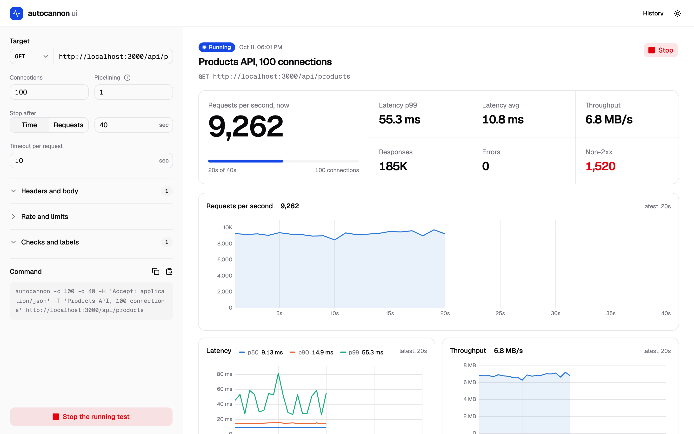
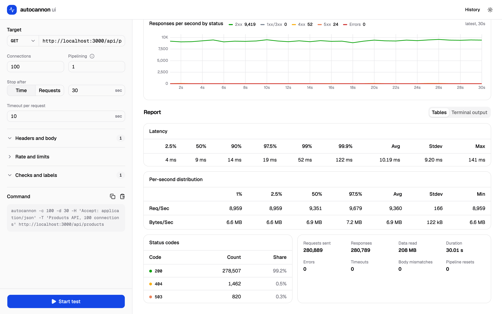
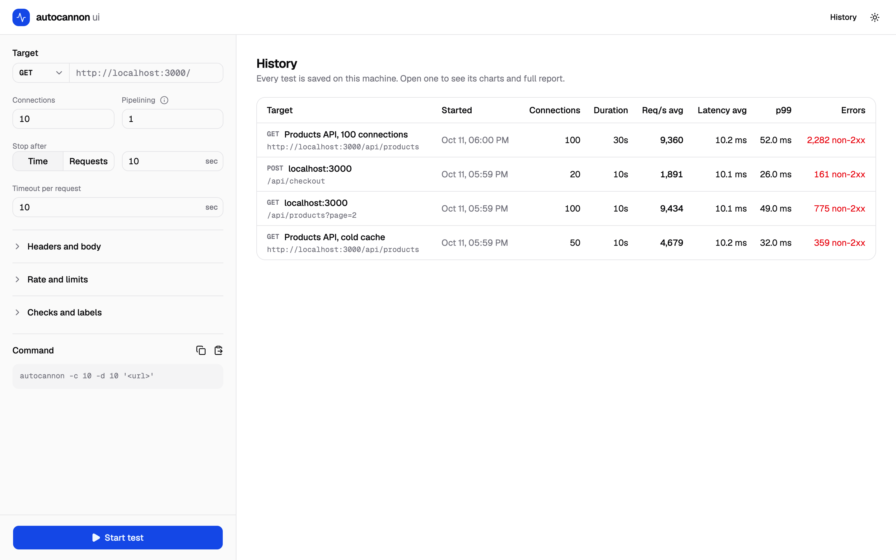

<div align="center">


# autocannon ui

**Run [autocannon](https://github.com/mcollina/autocannon) load tests from your browser and watch the results live.**

Requests per second, latency percentiles, throughput and status codes, updated every second.<br>
The same numbers as the CLI, without leaving the browser.

[](https://nodejs.org)
[](https://github.com/mcollina/autocannon)
[](https://svelte.dev/docs/kit)
[](https://github.com/leeoniya/uPlot)
[](LICENSE)

[Features](#features) · [Quick start](#quick-start) · [How to use it](#how-to-use-it) · [Options](#options) · [How the numbers are produced](#how-the-numbers-are-produced)

</div>

<br>

<picture>
  <source media="(prefers-color-scheme: dark)" srcset="docs/live-dark.png">
  
</picture>

## Why

autocannon is a fast, reliable way to load-test an HTTP server, but its output is a table printed once the test ends. autocannon ui runs the same engine and shows what happens second by second: when latency starts to climb, when errors appear, whether throughput holds steady. Every run is kept, so you can go back and compare.

It runs on your machine. No accounts, no cloud, no telemetry.

## Features

- **Live charts.** Requests/sec, latency p50/p90/p99, throughput and responses by status class (2xx, 3xx, 4xx, 5xx, connection errors), updated every second. Hover one chart and the others follow the same second.
- **Every autocannon option** you use on the command line: connections, duration or request count, pipelining, timeout, method, headers, body, rate limits, bailout, expected body and more.
- **The full report.** Latency percentiles, Req/Sec and Bytes/Sec distribution, counts per status code, and autocannon's own terminal output, ready to copy.
- **Terminal round-trip.** Paste an `autocannon …` command to fill the form, or copy the command that matches the form.
- **History.** Every test is saved as a JSON file. Reopen a run, download it, or load its settings to run it again with one change.
- **Light and dark theme.**

<table>
  <tr>
    <td width="50%">
      <picture>
        <source media="(prefers-color-scheme: dark)" srcset="docs/report-dark.png">
        
      </picture>
      <p align="center"><sub>The report when a test ends</sub></p>
    </td>
    <td width="50%">
      <picture>
        <source media="(prefers-color-scheme: dark)" srcset="docs/history-dark.png">
        
      </picture>
      <p align="center"><sub>Every run is kept in the history</sub></p>
    </td>
  </tr>
</table>

## Quick start

Requires Node.js 22 or newer.

```sh
git clone https://github.com/apofisxii/autocannon-ui.git
cd autocannon-ui
npm install
npm run dev
```

Open http://localhost:5173, enter a URL and press **Start test**.

To run the production build instead:

```sh
npm run build
npm start          # serves on http://127.0.0.1:3000
```

## How to use it

1. Enter the URL in **Target** and pick the HTTP method.
2. Set **Connections**, **Pipelining**, and when to stop: after a number of **seconds** or after a number of **requests**.
3. Open **Headers and body**, **Rate and limits** or **Checks and labels** for the other options. A badge on each section shows how many of its settings are in use.
4. Press **Start test**. You are taken to the live view. **Stop** ends the test early; the results collected so far are kept.
5. When the test ends, the **Report** section shows the tables. **Terminal output** shows the exact text autocannon would print.

From a finished run, **Use these settings** loads its options into the form so you can change one value and run again.

### Moving between the UI and the terminal

The **Command** box at the bottom of the form always shows the `autocannon` command for the current settings. Use the copy button to run it in a terminal.

The paste button does the opposite: paste a command such as

```sh
autocannon -c 100 -d 30 -p 10 -m POST -H "Content-Type: application/json" -b '{"id":1}' http://localhost:3000/api
```

and the form is filled in. Flags that only affect terminal output (`-j`, `-l`, `-n`, …) are ignored silently. Flags the UI does not support (workers, HAR files, forms, sockets) are listed in a notice.

## Options

| Form field                                            | CLI flag | Notes                               |
| ----------------------------------------------------- | -------- | ----------------------------------- |
| Connections                                           | `-c`     |                                     |
| Pipelining                                            | `-p`     |                                     |
| Stop after time                                       | `-d`     | seconds                             |
| Stop after requests                                   | `-a`     |                                     |
| Timeout per request                                   | `-t`     | seconds                             |
| Method                                                | `-m`     |                                     |
| Headers                                               | `-H`     | one row per header                  |
| Body                                                  | `-b`     |                                     |
| Overall rate                                          | `-R`     | requests/sec across all connections |
| Per-connection rate                                   | `-r`     | requests/sec per connection         |
| Max requests per connection                           | `-M`     |                                     |
| Max requests overall                                  | `-O`     |                                     |
| Reconnect every N requests                            | `-D`     |                                     |
| Give up after N errors                                | `-B`     |                                     |
| Expected body                                         | `-E`     | other bodies count as mismatches    |
| Title                                                 | `-T`     | shown in the history                |
| Replace `[<id>]` with a random id                     | `-I`     |                                     |
| Leave non-2xx responses out of latency and throughput | `-x`     |                                     |
| Ignore coordinated omission                           | `-C`     |                                     |

A value of 0 in **Rate and limits** means "no limit", as in the CLI.

## How the numbers are produced

- autocannon runs inside the web server process, through its Node.js API.
- The live charts are built from autocannon's per-response events, grouped in 1-second buckets. Latency percentiles in the charts are computed per bucket.
- The headline figures and tables shown after a test are autocannon's own summary, so they match what the CLI would print for the same run.
- Only one test runs at a time. Two tests from the same machine would compete for CPU and distort each other's results.

For reliable numbers, the same rules apply as with the CLI: the machine running the test should not be the bottleneck. Load tests against a server on the same machine measure both programs together.

## Data and configuration

| Environment variable | Default                      | What it does                                    |
| -------------------- | ---------------------------- | ----------------------------------------------- |
| `DATA_DIR`           | `./data`                     | Where run history is stored (`<DATA_DIR>/runs`) |
| `HOST`               | `127.0.0.1` with `npm start` | Interface the production server listens on      |
| `PORT`               | `3000` with `npm start`      | Port of the production server                   |

Each run is a single JSON file in `data/runs/`. Delete the files to clear the history.

> **Keep it local.** Anyone who can reach this server can make your machine send load-test traffic to any URL. Don't expose it to a network you don't trust.

## Tech

SvelteKit 3 (Svelte 5), Tailwind CSS 4 with shadcn-svelte components, uPlot for charts, autocannon 8. Live updates use Server-Sent Events.

## License

[MIT](LICENSE)
